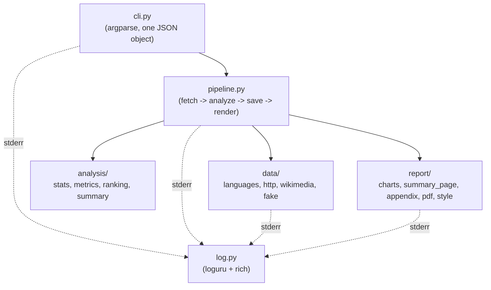
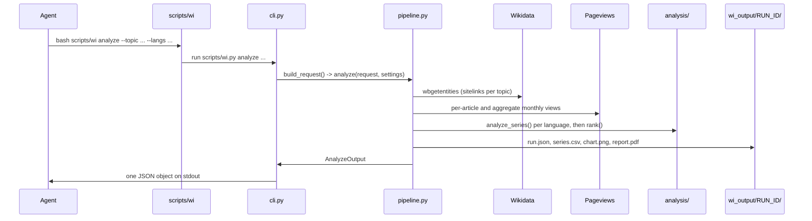

# Architecture

## 1. Purpose

`wiki-interest` measures how interest in a topic changes across Wikipedia language
editions. It reads Wikimedia pageview statistics and Wikidata sitelinks, then computes
a verdict, a confidence level and a ranking for each requested language.

An agent runs one command and relays the result. Deterministic Python code computes
every number and every verdict. The agent never computes a number itself.

## 2. Components

The `wiki_interest` package sits under `scripts/`. `scripts/wi` is the bash launcher;
`scripts/wi.py` adds `scripts/` to `sys.path` and calls `wiki_interest.cli.main`.



`config.py`, `enums.py`, `errors.py`, `models.py` and `text.py` hold the shared settings,
types and strings. The other modules import from them. These five modules import only
from each other, never from `data/`, `analysis/`, `report/` or `pipeline.py`.

## 3. Data flow



## 4. Module table

| Module | Responsibility |
|---|---|
| `wiki_interest/enums.py` | `StrEnum` types: `Verdict`, `Confidence`, `Flag`, `Reason`, `Why`, `Lang`, `Status`, `LogMode`. |
| `wiki_interest/models.py` | Pydantic models: the request, per-language results, `RunRecord` (`run.json`), the stdout models. |
| `wiki_interest/config.py` | `Settings` (from environment variables) and `Thresholds` (analysis constants). API URLs and CLI limits. |
| `wiki_interest/errors.py` | `WikiInterestError` and its subclasses. Each carries a `fix` hint. |
| `wiki_interest/text.py` | Every UI string, in Ukrainian and English, keyed by an enum. |
| `wiki_interest/log.py` | loguru sinks and the rich dashboard, all on stderr. |
| `wiki_interest/data/languages.py` | Language aliases, Wikidata site ids, edition names. |
| `wiki_interest/data/http.py` | `get_json`: disk cache, retry with `Retry-After`, the fake-API switch. |
| `wiki_interest/data/wikimedia.py` | Wikidata sitelinks and Pageviews requests; `collect()` runs them for one analysis. |
| `wiki_interest/data/fake.py` | Synthetic responses in the real API shape, for `WI_FAKE_API=1`. |
| `wiki_interest/analysis/stats.py` | YoY, bootstrap confidence interval, Theil–Sen trend, views per million. |
| `wiki_interest/analysis/metrics.py` | `analyze_series()`: verdict, confidence and flags for one language. |
| `wiki_interest/analysis/ranking.py` | `rank()`: score and `why` for each language, across the run. |
| `wiki_interest/analysis/summary.py` | `summary_text()`: the paragraph the agent bases its answer on. |
| `wiki_interest/report/charts.py` | The index chart and the year-over-year chart (shared by the PNG and the PDF). |
| `wiki_interest/report/style.py` | matplotlib setup: backend, palette, page size, text wrapping. |
| `wiki_interest/report/summary_page.py` | Page 1 of the PDF: the fixed one-page summary. |
| `wiki_interest/report/appendix.py` | The flowing appendix: ranking, per-language detail, limitations, monthly table. |
| `wiki_interest/report/content.py` | Text shared by page 1 and the appendix: title, auto conclusion, limitations list. |
| `wiki_interest/report/pdf.py` | `save_pdf()`: assembles page 1 and the appendix into one PDF. |
| `wiki_interest/pipeline.py` | `analyze()` and `rerender()`: one run from end to end. |
| `wiki_interest/cli.py` | argparse. Validates input and prints exactly one JSON object. |

## 5. Contracts

The stdout output is always one JSON object, on one line:

- `wi analyze` prints an `AnalyzeOutput` object on success, or an `ErrorOutput` on failure.
- `wi report` prints a `ReportOutput` object on success, or an `ErrorOutput` on failure.
- Field names and meanings are documented in `SKILL.md`. Do not change a field name
  without updating `SKILL.md`, the tests and the evals in the same change.

`run.json` inside `wi_output/<run_id>/` is a `RunRecord` (see `scripts/wiki_interest/models.py`).
`wi report --run-id` reads it back and must still load files written by earlier versions.

Every error, from a bad argument to a failed request, becomes:

```json
{"error": "<what went wrong>", "fix": "<a concrete next command or setting>"}
```

## 6. Key invariants

These rules come from `AGENTS.md`, section 5. This document must not contradict them.

1. stdout carries one JSON object and nothing else. All logs go to stderr through `loguru`.
2. A piped run (an agent's tool call) stays quiet on stderr, apart from warnings the JSON
   does not already show, so the agent's context stays small.
3. The stdout field names are a contract. A change to them needs a matching change to
   `SKILL.md`, the tests and the evals.
4. `wi report --run-id` must keep loading `run.json` files saved by earlier versions.
   Add new fields with a default value; do not remove or rename existing fields.
5. The cache key format in `data/http.py::cache_path` must not change. A new format
   discards every user's cache.
6. The statistics are deterministic. A change that affects a number needs a reason in
   the commit and an update to the tests.
7. UI text lives in `text.py`, in Ukrainian and in English.
8. Code uses the enums and the Pydantic models, never bare strings or plain dicts, for
   data that crosses module boundaries.
9. The `SKILL_FILES` list in the `Makefile` must list every top-level file the skill
   needs at runtime.

## 7. Caching

All network access goes through `data/http.py::get_json`. It builds a cache key from
the URL and the sorted parameters:

```python
key = url + "?" + json.dumps(params or {}, sort_keys=True)
path = cache_dir / (sha1(key.encode()).hexdigest() + ".json")
```

The cache directory is `WI_CACHE` (default `~/.cache/wiki-interest`). A cache entry
holds `{"fetched_at": <unix time>, "body": <response>}`. Two time-to-live values apply:

| Data | Time-to-live |
|---|---|
| Wikidata sitelinks (`resolve_topic`) | 30 days (`WIKIDATA_TTL_S` in `config.py`) |
| Pageviews (per-article and aggregate) | Forever. A completed month never changes. |

`WI_FAKE_API=1` skips the cache and the network. It returns synthetic data from
`data/fake.py` instead.

## 8. Determinism

The same input always gives the same output.

- The bootstrap confidence interval (`analysis/stats.py::bootstrap_ci`) uses
  `numpy.random.default_rng(THRESHOLDS.seed)`, with `seed = 42`.
- The trend statistics (Theil–Sen slope, Mann–Kendall p-value) are deterministic by
  construction.
- The synthetic API (`data/fake.py`) seeds its own random generator from an MD5 hash of
  the language and the request key, so a demo run gives the same numbers every time.

## 9. Thresholds

Every number that decides a flag, a verdict or a confidence level lives in one place:
the `Thresholds` model in `wiki_interest/config.py`, instantiated once as `THRESHOLDS`.
The formulas and the rule table are in `references/METHODOLOGY.md`.

| Field | Value | Meaning |
|---|---|---|
| `low_volume_median` | 300 | Median views/month below this triggers `LOW_VOLUME`. |
| `spike_share_max` | 0.40 | If the top month of the last year (minus the median month) gives more than 40% of the YoY gain, `SPIKE_DRIVEN` fires. |
| `project_shift_min` | 0.05 | If raw and normalized YoY have different signs and one of them is larger than 5% (absolute), `PROJECT_SHIFT` fires. |
| `p_significant` | 0.05 | The p-value below which the long-run trend counts as significant. |
| `bootstrap_iters` | 1000 | Resamples for the confidence interval. |
| `ci_level` | 0.90 | Width of the confidence interval. |
| `seed` | 42 | Fixed seed for the bootstrap. |
| `full_history_months` | 24 | Below this, `SHORT_HISTORY` fires and the YoY window shrinks. |

## 10. Languages and output text

`--out-lang` (`uk` or `en`, enum `Lang`) selects the language of `summary_text` and of
the whole PDF. `wiki_interest/text.py` holds every string for both languages, keyed by
the relevant enum (`Verdict`, `Confidence`, `Flag`, `Reason`, `Why`) or by a plain key
for PDF layout text (`PDF_TEXT`).

Error messages and `fix` hints (`errors.py`) are always in English. They are read by the
agent, not shown to the end user, so they are not translated.

## 11. PDF structure

Every `analyze` run writes a PDF report unless `--no-pdf` is given. `wi report` re-renders
an existing PDF, optionally with a new conclusion, question or `--out-lang`.

| Part | Content | Module |
|---|---|---|
| Page 1 (fixed layout) | Title, subtitle, a red demo banner if `WI_FAKE_API=1`, the conclusion (cut to 700 characters), the index chart, the year-over-year chart, the per-language metrics table, the limitations list, a footer with article titles and the source. | `report/summary_page.py` |
| Appendix (flowing, as many pages as needed) | The full conclusion (only if page 1 cut it), the ranking table with scores, full per-language detail with confidence reasons, the complete limitations list, the monthly pageviews table. | `report/appendix.py` |

The appendix uses a `Flow` helper that places text and tables from the top of a page
downward and starts a new page when the current one is full. Table headers repeat on
each new page, and no row of the monthly table is dropped.
