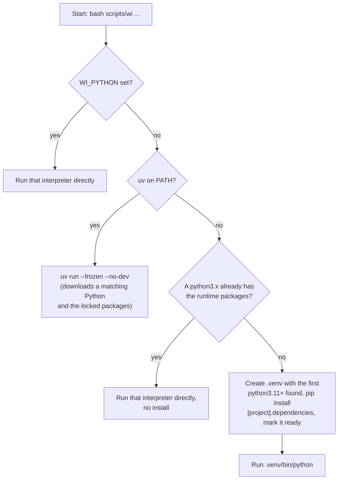

# Installation guide

## 1. Requirements

| Requirement | Notes |
|---|---|
| `bash` | Runs `scripts/wi`. |
| `uv`, or Python 3.11–3.14 | `uv` is preferred. It downloads a suitable Python by itself. |
| Network access to `wikimedia.org` and `www.wikidata.org` | Needed for every real `analyze` run. Not needed with `WI_FAKE_API=1`. |
| Network access to PyPI (or uv's Python downloads) | Needed only for the first install, to fetch Python and the dependencies. |

The first run creates a virtual environment. It takes about one minute. Later runs take
about two seconds.

## 2. How `scripts/wi` picks an environment

`scripts/wi` checks four conditions in order and stops at the first one that matches.



1. **`WI_PYTHON` is set.** `scripts/wi` runs that interpreter as is, with no check and no
   install. Use this to pin an exact interpreter.
2. **`uv` is on `PATH`.** `scripts/wi` runs `uv run --quiet --frozen --no-dev`. `uv`
   downloads a Python version that satisfies `requires-python` in `pyproject.toml`
   (3.11–3.14) if none is installed, and installs the exact versions pinned in `uv.lock`
   into `.venv`.
3. **No `uv`, but a `python3`, `python3.11`, `python3.12`, `python3.13` or `python3.14`
   on `PATH` already has the runtime packages** (pandas, numpy, scipy, matplotlib,
   requests, pydantic, rich, loguru, pandas major version 2 or later). `scripts/wi` runs
   it directly. This covers a sandbox that has all eight packages. If one package is
   missing, path 4 applies.
4. **Otherwise.** `scripts/wi` finds the newest available `python3.14`…`python3.11`
   (or `python3`) on `PATH`, creates `.venv`, and installs `[project].dependencies` from
   `pyproject.toml` with pip. This path uses version ranges, not the exact pins in
   `uv.lock`. A marker file, `.venv/.wi-ready`, is written only after the install
   succeeds, so a half-built `.venv` is rebuilt on the next run.

If no path matches (no `uv` and no Python 3.11 or later), `scripts/wi` prints this JSON
error to stdout and exits with code 1:

```json
{"error":"Python >= 3.11 not found and uv is not installed","fix":"install uv (curl -LsSf https://astral.sh/uv/install.sh | sh); it downloads the right Python by itself. Then re-run the same command."}
```

## 3. Environment variables

All variables below are read by `wiki_interest/config.py::Settings.from_env()`, except
`WI_PYTHON`, which the bash launcher reads before Python starts.

| Variable | Default | Meaning |
|---|---|---|
| `WI_CONTACT` | `https://github.com/ ; set WI_CONTACT env var` | Contact text added to the `User-Agent` header. Wikimedia asks every client for one. |
| `WI_CACHE` | `~/.cache/wiki-interest` | Directory for the disk cache of Wikidata and Pageviews responses. |
| `WI_OUT` | `wi_output` (relative to the current directory) | Directory where `run.json`, `series.csv`, `chart.png` and `report.pdf` are written. |
| `WI_OFFLINE` | unset (off) | Set to `1` to use only the disk cache. A cache miss then fails with a `fix` hint instead of a network request. |
| `WI_FAKE_API` | unset (off) | Set to `1` to use synthetic Wikidata and Pageviews responses (`data/fake.py`). No network access. The PDF then shows a red demo banner. |
| `WI_LOG` | unset (`auto`) | stderr logging mode: `auto`, `rich`, `plain` or `quiet`. See `docs/007-logging-and-diagnostics.md`. The `--log` command-line flag overrides it. |
| `WI_LOG_LEVEL` | `INFO` | loguru level, for example `DEBUG`. `DEBUG` also logs every cache hit and every HTTP request. |
| `WI_PYTHON` | unset | Path to a Python interpreter. When set, `scripts/wi` runs it directly and skips the `uv`/pip checks. |
| `WI_SHARE_DIR` | `/mnt/user-data/outputs` if that folder exists and is writable, else off | Folder that the chat shows to the user. `analyze` and `report` copy the PDF into it and return the copy as `files.pdf_shared`. Set it to `off` to stop the copy. |

Set `WI_CONTACT` before your first real run:

```bash
export WI_CONTACT="you@company.com"
```

## 4. Verify the install

Run the offline demo. It needs no network access and no `WI_CONTACT`:

```bash
WI_FAKE_API=1 bash scripts/wi analyze --topic "Intermittent fasting" --langs pl,cs --months 24
```

or, with the shortcut in the `Makefile`:

```bash
make demo
```

A working install prints one JSON object to stdout and writes `wi_output/<run_id>/` with
`run.json`, `series.csv`, `chart.png` and `report.pdf`. The PDF carries a red
"DEMO: SYNTHETIC DATA" (or Ukrainian "ДЕМО: СИНТЕТИЧНІ ДАНІ") banner, because the data is
not real.

## 5. Troubleshooting

| Symptom | Cause | Fix |
|---|---|---|
| `{"error":"Python >= 3.11 not found and uv is not installed", ...}` | No `uv` and no Python 3.11+ on `PATH`. | Install `uv`: `curl -LsSf https://astral.sh/uv/install.sh \| sh`. Then re-run the same command. |
| A cold run with 3 or more topics is slow, and stderr shows `wi: warning: HTTP 429 from www.wikidata.org, retry 2/5 in 15 s` | The anonymous rate limit of Wikidata answers with HTTP 429 and a `Retry-After` header (about 15 seconds). | No action is necessary. `data/http.py` reads `Retry-After` and tries again, up to 5 attempts. |
| `{"error":"offline mode and no cache for ...", "fix":"unset WI_OFFLINE or run once with network access"}` | `WI_OFFLINE=1` is set and the request is not yet in the cache. | Unset `WI_OFFLINE`, or run the same command once with network access to fill the cache. |
| `wi: warning: PDF font has no glyph for ...; these characters show as empty boxes` | The PDF font (DejaVu Sans) has no Chinese, Japanese or Korean glyphs. | Expected for CJK topic titles or article names. Cyrillic, Polish, Czech and Vietnamese characters are not affected. |
| The first run takes about a minute | `scripts/wi` is downloading a Python (via `uv`) or building `.venv` with pip. | Expected. Later runs take about two seconds. |

See `docs/006-cli-reference.md` for every error the CLI itself can return, with its
`fix` hint.
