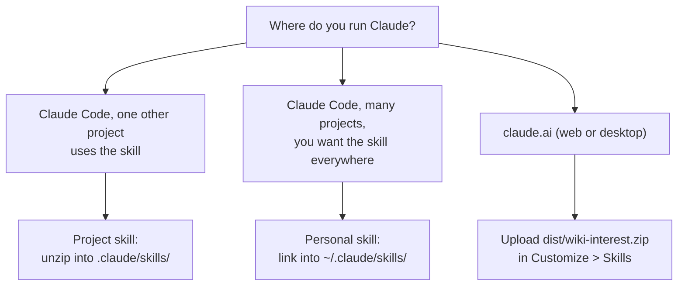

# Install and onboard the skill in Claude

Facts in this document about Claude Code and claude.ai were checked against the
official documentation on 2026-09-27.

## 1. Choose your install path



| Path | Where the skill runs | Best for |
|---|---|---|
| Claude Code, personal skill | Your machine, any project directory | You use `wiki-interest` across several repositories. |
| Claude Code, project skill | Your machine, one project only | The skill is part of the workflow of one project. The team gets it through source control. |
| claude.ai upload | Anthropic's code-execution sandbox | You do not use Claude Code, or you want to share the skill without a checkout. |

## 2. Claude Code: personal skill

Claude Code reads a personal skill's `SKILL.md` from
`~/.claude/skills/<skill-name>/SKILL.md`. The folder name gives the slash command
(`/wiki-interest`); Claude can also select the skill on its own, from its description.

**Option A: symlink to this checkout** (keeps updates in sync when you `git pull`):

```bash
mkdir -p ~/.claude/skills
ln -s "$(pwd)" ~/.claude/skills/wiki-interest
```

**Option B: copy the built skill zip** (an independent, frozen copy):

```bash
make skill_zip
mkdir -p ~/.claude/skills/wiki-interest
unzip -q dist/wiki-interest.zip -d /tmp/wiki-interest-unzip
cp -R /tmp/wiki-interest-unzip/wiki-interest/. ~/.claude/skills/wiki-interest/
rm -rf /tmp/wiki-interest-unzip
```

## 3. Claude Code: project skill

A project skill lives in `.claude/skills/<skill-name>/SKILL.md`. Claude Code loads it from
the start directory and its parent directories, up to the repository root. Use a project
skill when one other project uses `wiki-interest`.

> **Caution:** Do not link this repository into its own `.claude/skills/` folder. The
> link then points to its own parent, and recursive tools (`grep -r`, `find -L`) can loop.
> To test the skill while you develop it, use a personal skill (section 2, option A).

1. Build the skill zip in this repository:
   ```bash
   make skill_zip
   ```
2. Go to the other project and unzip the skill into its `.claude/skills/` folder:
   ```bash
   mkdir -p .claude/skills
   unzip -q /path/to/wiki-interest/dist/wiki-interest.zip -d .claude/skills/
   ```
3. Commit `.claude/skills/wiki-interest/` so that the team gets the skill.

Claude Code also reads `AGENTS.md` directly (from version 2.1.277). It does this only
when no `CLAUDE.md` or `CLAUDE.local.md` exists next to it. This repository has a
`CLAUDE.md` that imports `AGENTS.md` with `@AGENTS.md`, so Claude Code reads both: the
shared rules from `AGENTS.md` and the Claude-specific notes from `CLAUDE.md`.

## 4. claude.ai (web or desktop)

1. Build the skill zip:
   ```bash
   make skill_zip
   ```
   This writes `dist/wiki-interest.zip` (about 190 KB). Always use this command. A zip
   of the project folder made by hand includes `.venv` and is too large.
2. In Claude, open **Customize > Skills**.
3. Click **+**, then **+ Create skill**, then **Upload a skill**.
4. Upload `dist/wiki-interest.zip`.
5. Turn on code execution, if it is not already on:
   - Free, Pro or Max: **Settings > Capabilities**.
   - Team or Enterprise: **Organization settings > Plugins & skills**, **Policy** tab.
   Skills are available on the Free, Pro, Max, Team and Enterprise plans.

The skill needs network access to `wikimedia.org` and `www.wikidata.org` from the
code-execution sandbox, and to PyPI if a dependency is not already installed there. If
your organization restricts egress from the sandbox, allow these domains. This
documentation does not name an exact settings menu for that restriction; ask your
workspace administrator if `wikimedia.org` and `www.wikidata.org` are not already
allowed.

## 5. First use

Set your contact address once, so Wikimedia can identify the client in case of abuse:

```bash
export WI_CONTACT="you@company.com"
```

On claude.ai, there is no shell to export a variable in. Tell Claude your contact
address in the chat, or accept the default and let Claude pass `WI_CONTACT` when it runs
the command.

Ask a question in the skill's domain. Example prompts, in English and in Ukrainian (from
`SKILL.md` and `evals/scenarios.json`):

| Language | Prompt |
|---|---|
| English | "Compare growth of interest in intermittent fasting in Polish vs Czech Wikipedia, last 2 years." |
| Ukrainian | "Порівняй зростання інтересу до інтервального голодування в польськомовній та чеськомовній Wikipedia за останні два роки." |
| English | "Is interest in astronomy growing in Ukrainian Wikipedia, and how far can we trust it?" |
| Ukrainian | "Ми думаємо додати курс з астрономії до освітнього застосунку. Чи зростає інтерес до цієї теми в україномовній Wikipedia, і наскільки цьому зростанню можна довіряти?" |

A good answer:

1. Gives a direct answer first (for example, "Yes, it is growing, with medium confidence").
2. Quotes the key numbers from the tool output, not rounded again.
3. States the reason for that confidence level.
4. Names language editions, not countries (for example, "Portuguese Wikipedia", not
   "Portugal").
5. Ends with the PDF report as a file card that you can open or download.

How the PDF gets to you:

| Where you run Claude | What happens |
|---|---|
| claude.ai (web, desktop, mobile) | The skill copies the PDF to the outputs folder of the sandbox (`/mnt/user-data/outputs/`). `SKILL.md` tells Claude to show it with its file tool (`present_files`). The PDF then shows as a file card in the chat. |
| Claude Code desktop | Claude sends `report.pdf` with its send-file tool. The PDF opens in the side panel. |
| Claude Code in a terminal | Claude gives the full path to `wi_output/<run_id>/report.pdf` on your machine. |

If Claude gives only a path on claude.ai, ask it: "Show me the PDF as a file."

## 6. Verify with the offline demo

Ask Claude to run the skill in demo mode, so you can check it works without spending a
real request against Wikimedia:

> Run the wiki-interest skill with WI_FAKE_API=1 for "Intermittent fasting" in Polish and
> Czech, and show me the PDF path.

This runs the same command as `make demo`:

```bash
WI_FAKE_API=1 bash scripts/wi analyze --topic "Intermittent fasting" --langs pl,cs --months 24 --pdf
```

The resulting PDF carries a red "DEMO: SYNTHETIC DATA" banner, because the numbers are
synthetic.

## 7. Troubleshooting

| Symptom | Cause | Fix |
|---|---|---|
| Claude does not offer `/wiki-interest` | The skill folder, or its symlink, is missing, or `SKILL.md` is not at its root. | Check `ls ~/.claude/skills/wiki-interest/SKILL.md` (personal) or `ls .claude/skills/wiki-interest/SKILL.md` (project). |
| The skill runs, but every request fails | No network access to `wikimedia.org` or `www.wikidata.org` from the sandbox. | Ask Claude to run the offline demo (`WI_FAKE_API=1`) to confirm the code itself works, then fix the sandbox's egress rules. |
| The uploaded zip is refused as too large | The zip includes files outside the `SKILL_FILES` allowlist, for example `.venv` or `wi_output`. | Rebuild with `make skill_zip`; do not zip the project folder by hand. |
| The PDF path in the answer does not exist | The run used `--no-pdf`, or the topic has no article in any requested language. | Re-run with `--pdf` and a broader `--topic`, or check `warnings` in the JSON output. |
| First run is slow | `scripts/wi` is installing dependencies (see `docs/002-installation-guide.md`). | Expected once, about a minute. Later runs take about two seconds. |

See `docs/002-installation-guide.md` for launcher and environment-variable
troubleshooting that applies everywhere, not only in Claude.

## 8. Claude API (advanced)

Custom skills can also be uploaded through the Skills API: `POST /v1/skills`, as
`multipart/form-data`, with every file under one top-level folder and `SKILL.md` at its
root. `make skill_zip` builds a zip with this layout. See
<https://platform.claude.com/docs/en/build-with-claude/skills-guide> for the request format
and the size limit.
